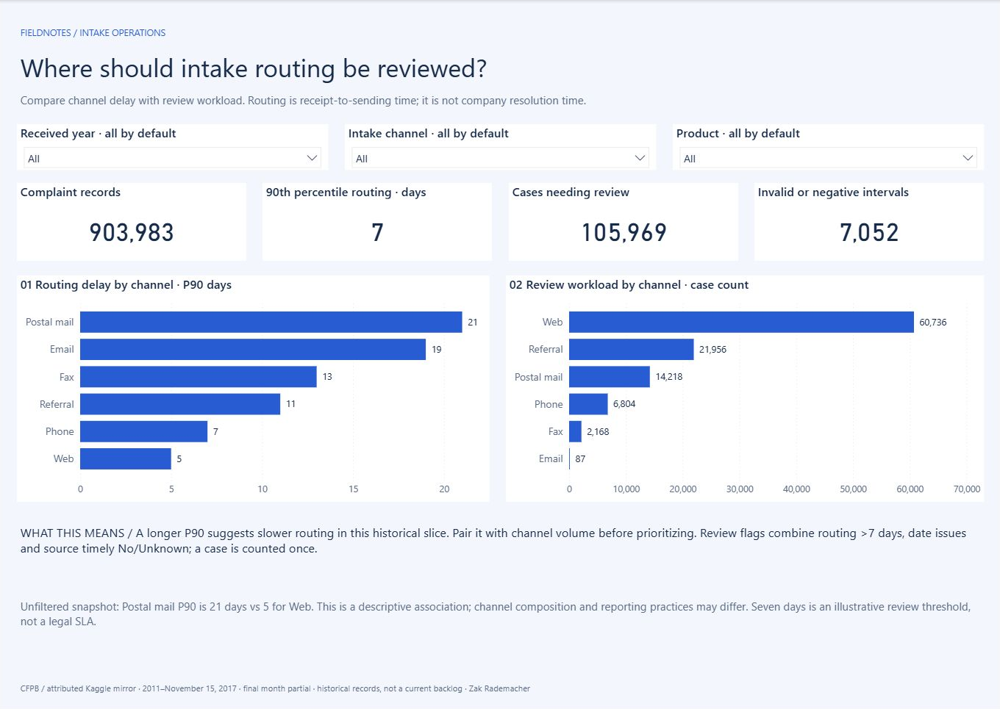

# Complaint Intake Review

I used **903,983 historical complaint records** to look at intake routing: how long records took to move from receipt to sending, where unusual intervals appeared, and how a reviewer could keep notes between refreshes.

Python and SQLite prepare the data. A **two-page Power BI report** compares routing intervals with review workload, and an Excel workbook shows selected cases for review.

[Download the Power BI report](deliverables/Complaint%20Intake%20Review.pbix) · [Open and refresh](powerbi-rebuild/README.md) · [Read the method](docs/METHOD.md)



## What the snapshot shows

| Measure | Result |
|---|---:|
| Complaint records | 903,983 |
| Source timely flag: Yes | 879,376 (97.28% of known flags) |
| Nonnegative routing intervals | 896,931 |
| Median / P90 routing interval | 0 / 7 calendar days |
| Negative intervals, flagged separately | 7,052 |
| Routing intervals above seven days | 78,562 |
| Cases in the review queue, across all reasons | 105,969 |

Routing means **sent date minus received date**. It doesn't measure how long a company took to resolve a complaint. The source's timely-response flag is a separate measure, and the seven-day cutoff is an illustrative review rule.

Review reasons can overlap, but each case enters the queue once. Negative intervals stay visible as date issues. The historical snapshot isn't a current backlog, and complaint counts aren't a fair ranking of lender quality.

## Review and keep notes

The [Excel workbook](deliverables/complaint-operations-review.xlsx) contains an overview, monthly report, and **100 selected review examples**. These examples are neither the full queue nor a representative sample.

Notes are stored separately from generated results and rejoined by Complaint ID. To carry edits forward, export the **Review queue** sheet as UTF-8 CSV, then run:

```sh
python src/update_notes.py exported-review-queue.csv
python src/pipeline.py
```

[Excel and notes guide](docs/EXCEL_GUIDE.md) · [PDF briefing](deliverables/case-study.pdf)

## Reproduce the core project

From the repository root, using Python 3.10+ and the standard library:

```sh
python src/download_data.py
python src/pipeline.py
python -m unittest discover -s tests -v
```

Allow about 1 GB of free space and several minutes for the full run. The download is about 112 MB; the extracted CSV is about 413 MB. If the public download endpoint changes, place `Consumer_Complaints.csv` in `data/raw/` using the source link below.

The full database and row-level exports are generated locally and excluded from the compact repository. New runs publish through `results/latest.json`; `python src/publication.py` locates the current files. Checked-in root results remain historical references. [Versioning and recovery](docs/RESULT_VERSIONS.md).

## Documentation

- [Report guide](powerbi-rebuild/README.md) · [Data dictionary](docs/DATA_DICTIONARY.md) · [Sources](docs/SOURCES.md)
- [Verification](docs/QA_REPORT.md) · [Walkthrough](docs/PROJECT_WALKTHROUGH.md)
- [Pipeline](src/pipeline.py) · [SQL reports](sql) · [Tests](tests)
- [Cover](deliverables/portfolio-cover-wide.png) · [Motion preview](deliverables/portfolio-motion.webm) · [Visual maintenance](docs/VISUAL_DESIGN.md)

This independent project uses a [Kaggle mirror](https://www.kaggle.com/datasets/sebastienverpile/consumercomplaintsdata) of the [CFPB Consumer Complaint Database](https://www.consumerfinance.gov/data-research/consumer-complaints/), covering December 1, 2011–November 15, 2017. Public complaints aren't a statistical sample of all consumer experiences. Derived exports omit narratives, company names, ZIP, state, and tags. Source mirror: CC0 Public Domain; original code: MIT.
