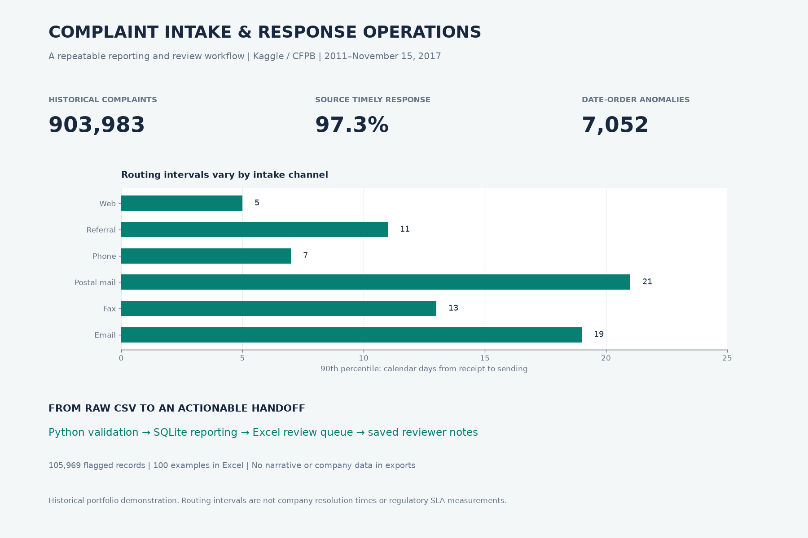

# Complaint Intake & Response Operations

**Python · SQLite · Excel · recurring operations reporting**

An operations reporting project using **903,983 real complaint records** from a historical Kaggle mirror of the CFPB database. It converts a large CSV into validated SQL reports and an Excel review queue, and preserves reviewer notes between runs.



## Inspect the work

- [Two-page management briefing](deliverables/case-study.pdf)
- [Excel workbook](deliverables/complaint-operations-review.xlsx) — overview, monthly report and 100 editable review examples
- [Python pipeline](src/pipeline.py), [six SQL reports](sql), [25 automated tests](tests)
- [Method](docs/METHOD.md), [data dictionary](docs/DATA_DICTIONARY.md), [Excel / notes guide](docs/EXCEL_GUIDE.md), [verification](docs/QA_REPORT.md)
- [Five-minute walkthrough](docs/PROJECT_WALKTHROUGH.md), [source and license](docs/SOURCES.md)

## Why this work is useful

The deliverables demonstrate CSV cleanup, recurring report preparation, SQL aggregation, spreadsheet formulas, exception handling and documented handoff. The project includes stable-ID review-note persistence, a practical requirement when another person reviews an export and the source is refreshed later. This is a personal portfolio demonstration; no client or employer engagement is claimed.

## Results from the complete snapshot

| Measure | Result |
|---|---:|
| Complaint records | 903,983 |
| Source timely flag: Yes | 879,376 (97.28% of known flags) |
| Nonnegative routing intervals | 896,931 |
| Median / P90 interval | 0 / 7 calendar days |
| Negative intervals, flagged separately | 7,052 |
| Routing interval above 7 days | 78,562 |
| Review queue across all flag reasons | 105,969 |

**Interpretation:** routing is the recorded sent date minus received date, not company resolution time. The seven-day cutoff is a demonstration review rule, not a legal SLA. The source's timely-response flag measures something different. November 2017 ends on Nov 15. Do not interpret these historical records as a current backlog or compare lender quality from complaint volumes.

## Reproduce the core project

Python 3.10+; the pipeline and tests use only the standard library. Download size is about 112 MB, extracted CSV about 413 MB. Allow approximately 1 GB free space and several minutes for the full run.

```sh
python src/download_data.py
python src/pipeline.py
python -m unittest discover -s tests -v
```

The downloader uses the public Kaggle dataset endpoint. If its access policy changes, download `Consumer_Complaints.csv` manually from the linked Kaggle page into `data/raw/`. The delivered source fingerprint is recorded in `results/analysis.json`; upstream snapshots may change.

Generated locally inside the published snapshot: `complaints.sqlite`, the complete `review_queue.csv`, `quality_issues.csv`, and all aggregate reports. Raw data, database and full row-level exports are excluded from the compact repository. The delivered workbook shows only 100 selected review examples. They are not a representative sample.

## Current results and recovery

New runs publish a complete version through `results/latest.json`. Run `python src/publication.py` to locate the current database, CSVs and analysis record. Checked-in root-level results remain historical reference files. [Versioned results and recovery](docs/RESULT_VERSIONS.md) explains failure handling and rebuilds.

### Carry notes into the next run

Export the **Review queue** Excel sheet as UTF-8 CSV (one sheet), then:

```sh
python src/update_notes.py exported-review-queue.csv
python src/pipeline.py
```

See the [Excel guide](docs/EXCEL_GUIDE.md) for statuses, validation, refresh and limits. No fictitious completed reviews are supplied.

### Optional presentation rebuild

```sh
pip install -r requirements-visuals.txt
python tools/build_presentation.py
node tools/build_workbook.mjs /absolute/path/to/complaint-operations
```

The workbook builder requires `@oai/artifact-tool`, supplied by a compatible spreadsheet authoring runtime. Set `RETAIL_ARTIFACT_ROOT` to that runtime's Node dependency root when necessary. The checked-in XLSX is ready to inspect; the Python/SQL workflow and tests do not require that optional authoring package. Artifact-tool recalculation was tested; native Excel was not available.

```sh
pip install -r requirements-qa.txt
python tools/verify_outputs.py
python tools/package_project.py
```

## Repository layout

`src/` ingestion and note import · `sql/` readable reports · `tests/` edge cases · `data/review_notes.csv` persistent annotation input · `results/` aggregates and evidence · `deliverables/` client-facing files · `docs/` handoff · `tools/` presentation, verification and packaging.

## Data and license

[Kaggle dataset](https://www.kaggle.com/datasets/sebastienverpile/consumercomplaintsdata), labeled CC0 Public Domain, originally the [CFPB Consumer Complaint Database](https://www.consumerfinance.gov/data-research/consumer-complaints/). The snapshot covers Dec 1, 2011–Nov 15, 2017. Code: MIT. Derived exports omit narratives, company names, ZIP, state and tags. Public complaints are not a statistical sample of all consumer experiences.

Workbook authoring also uses Python 3.10+ for display-only theme metadata normalization. Set `PYTHON` to its executable if `python` is unavailable. This helper preserves native workbook parts and does not recalculate formulas.
